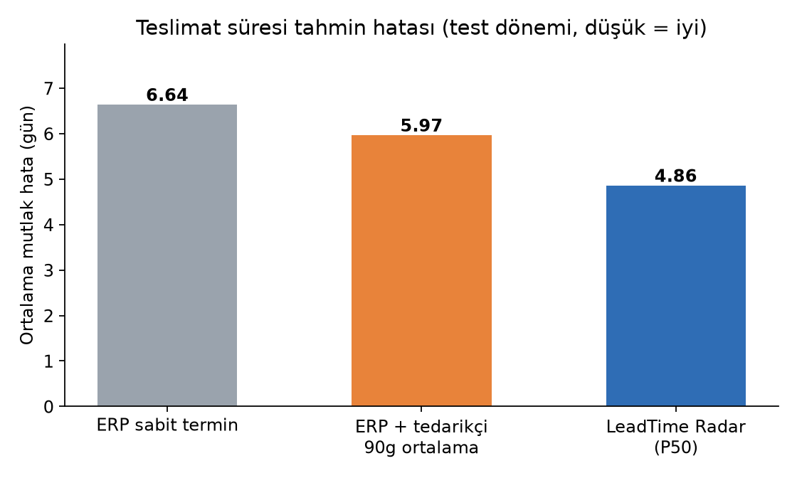
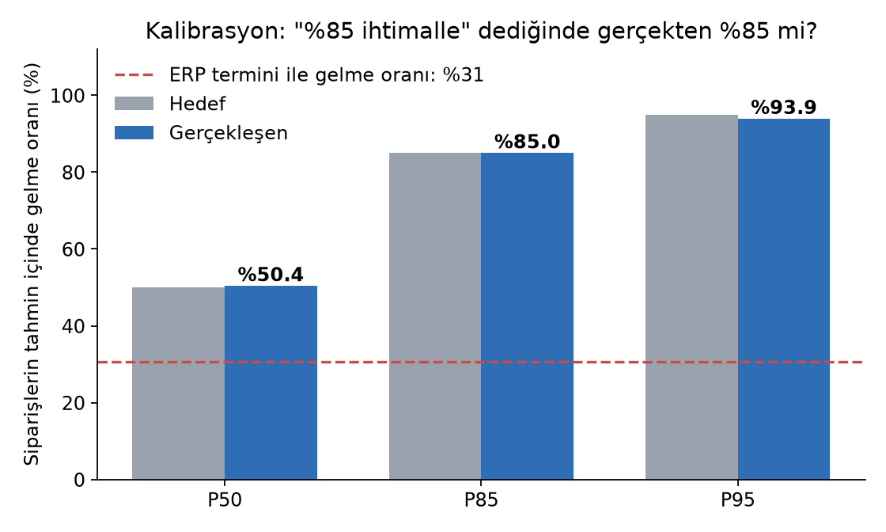
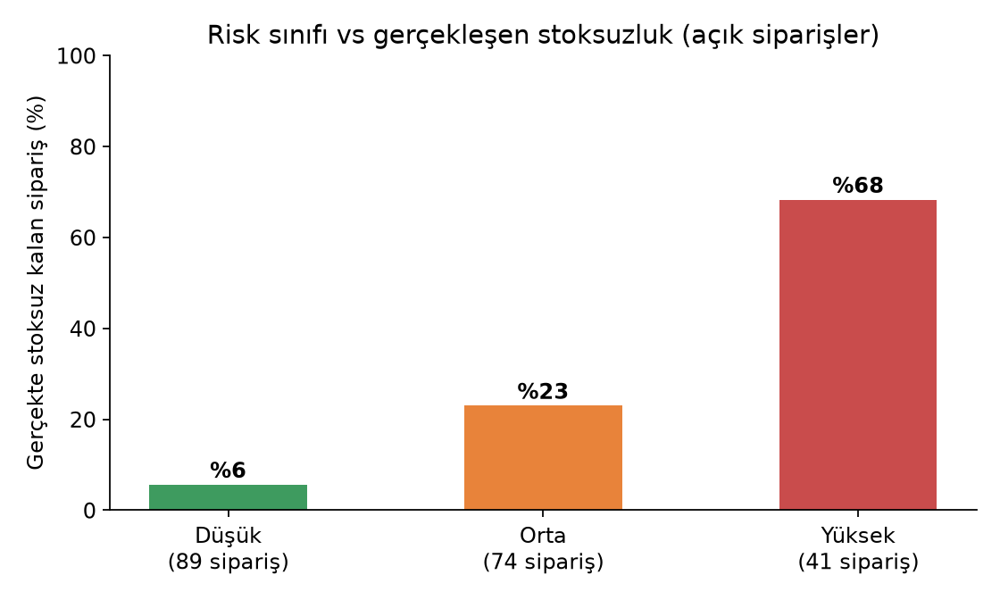
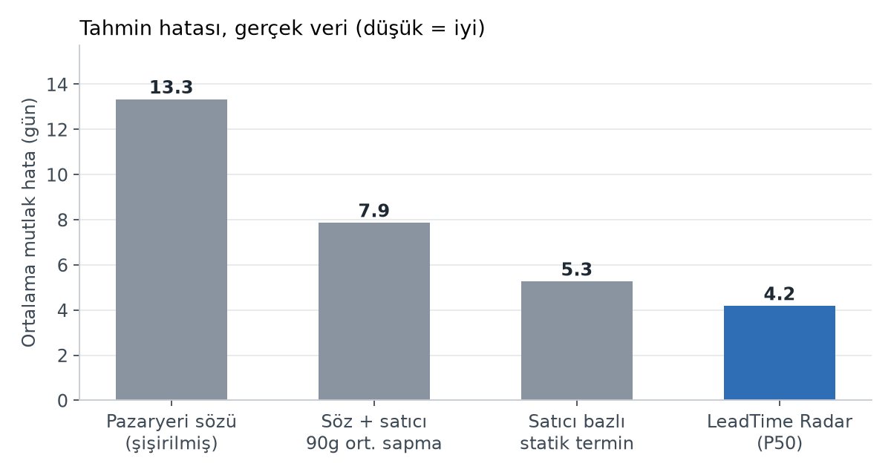
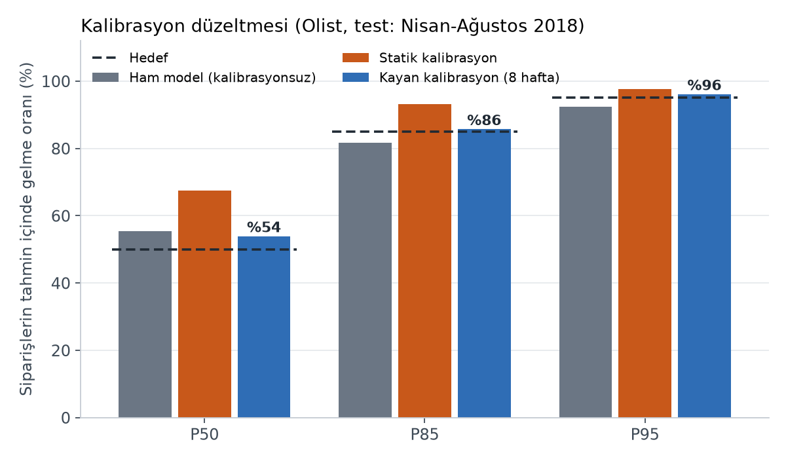
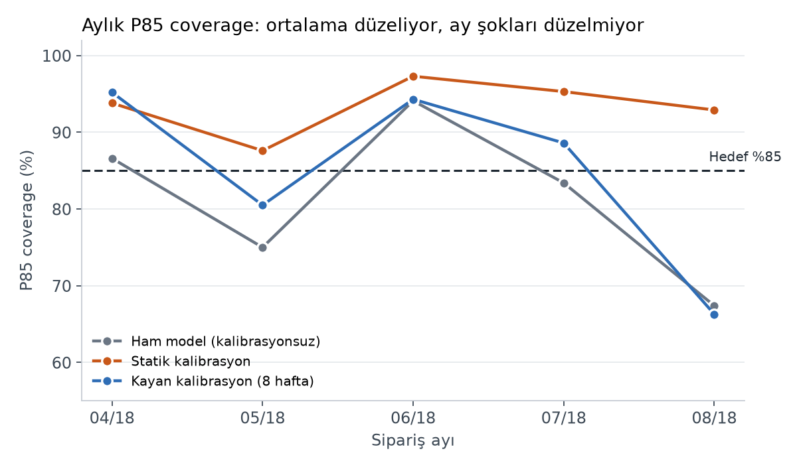
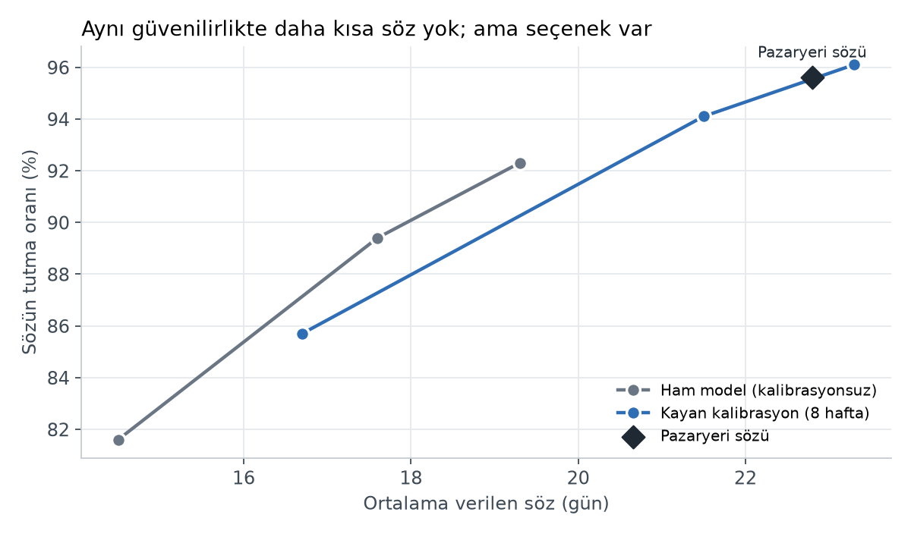

https://github.com/user-attachments/assets/becc3fb1-3d0a-4ea3-8815-749f51845424

<!-- DEMO VİDEOSU: GitHub'da bu dosyayı düzenle (kalem simgesi), LeadTime_Radar_Tanitim.mp4 dosyasını bu satırın altına sürükle-bırak. GitHub otomatik bir video linki ekler. Sonra bu yorum satırını silebilirsin. -->

# LeadTime Radar

**Tedarikçi teslimat süresi tahmini ve stok riski için masaüstü karar destek aracı.**

ERP'de teslimat süresi (termin) çoğunlukla tek bir sabit sayıdır ("14 gün"). Gerçekte süre bir
**dağılımdır**: sipariş miktarına, mevsime, mesafeye ve tedarikçinin yüküne göre değişir. Sabit
sayıya göre yapılan planlama iki yönde de bozulur: termin iyimserse gecikme üretim hattı durana kadar
fark edilmez, temkinliyse gereksiz stok tutulur.

LeadTime Radar, geçmiş sipariş verisinden her sipariş için **olasılıksal teslimat aralığı**
(P50 / P85 / P95) tahmin eder, bunu eldeki stokla birleştirip **stoksuz kalma riskini** hesaplar ve
satın almacıya doğal dilde aksiyon raporu üretir.

> **Veri hakkında açık not:** Proje iki ayak üzerinde duruyor.
> 1. **Sentetik veri** (`01_generate_data.py`): gerçeği bildiğimiz kontrollü bir test. Tedarikçi
>    davranışı, mevsimsellik, miktar ve yoğunluk etkisi kasıtlı olarak yazıldı; model bunları geri
>    bulabiliyor mu diye bakılıyor. **Buradaki sonuçlar gerçek dünya performansı değildir.**
> 2. **Gerçek veri** (`real_data/`): Olist e-ticaret teslimat verisi. Bir *satın alma* verisi değil,
>    *müşteriye teslimat* verisidir; "ERP termini" yerine pazaryerinin müşteriye verdiği tahmini
>    teslim tarihi kullanıldı. Yapı aynıdır (sabit söz vs gerçekleşen dağılım).

> Yeni bir algoritma icat edildiği iddiası yoktur. Amaç, satın almadaki "sabit termin" alışkanlığını ölçülebilir bir aralık tahminiyle karşılaştırmaktır.

## Hızlı başlangıç (Windows)

1. Python 3.11 veya 3.12 kurun (python.org, kurulumda **Add Python to PATH** işaretli olsun).
2. `setup.bat` dosyasına çift tıklayın. Sanal ortamı kurar, paketleri yükler, sentetik veriyi, modelleri ve grafikleri üretir.
3. `run_app.bat` ile masaüstü uygulamasını açın.
4. İsteğe bağlı, LLM raporu: `.env.example` dosyasını `.env` olarak kopyalayın ve `ANTHROPIC_API_KEY` yazın. Anahtar yoksa uygulama kural tabanlı şablon raporla çalışır.
5. İsteğe bağlı, gerçek veri deneyi: Olist CSV'lerini `real_data/olist_data/` klasörüne koyun ve `run_real_data.bat` çalıştırın.

Elle: `python -m venv .venv`, `.venv\Scripts\activate`, `pip install -r requirements.txt`, sonra `01` → `05` numaralı scriptler sırayla, en son `python desktop_app.py`.

## Klasör yapısı

```
leadtime-radar/
├── 01_generate_data.py        Sentetik PO verisi ve SQLite şeması (ERP benzeri tablolar)
├── 02_features_baseline.py    SQL ile özellikler, zaman bazlı bölme, baseline'lar
├── 03_train_quantile.py       P50 / P85 / P95 modelleri, coverage ve pinball loss
├── 04_risk_engine.py          Stokla birleştirme, risk sınıfları, geriye dönük test
├── 05_make_charts.py          README grafikleri
├── scoring.py                 CSV'den yüklenen açık siparişleri puanlama
├── report_generator.py        LLM raporu + sayı doğrulama + şablon rapor
├── desktop_app.py             Masaüstü arayüz (CustomTkinter)
├── real_data/                 Olist gerçek veri deneyi (import, deney, kalibrasyon, grafik)
├── docs/                      Grafikler ve proje özeti (PDF)
├── setup.bat / run_app.bat / run_real_data.bat
└── TEKNOLOJILER.md            Kullanılan araçlar ve kurulum notları
```

## 1) Sentetik veri sonuçları (kontrollü test)

Test dönemi: 2025 Ocak-Haziran, 1.645 sipariş. Zaman bazlı ayrım (eğitim 2022-2024).

| Yöntem | Ortalama hata (MAE, gün) |
|||
| ERP sabit termin | 6,64 |
| ERP + tedarikçinin son 90 gün ortalama gecikmesi | 5,97 |
| **LeadTime Radar (P50)** | **4,85** |



Kalibrasyon: P50 / P85 / P95 aralıkları gerçekte %50,0 / %85,8 / %94,8 tuttu. ERP termini siparişlerin
yalnızca %30,7'sini karşıladı.



**Stok riski (204 açık sipariş, simülasyonda gerçek varış tarihleri bilindiği için geriye dönük test):**



| | İşaretlenen sipariş | Yakalanan gerçek stoksuzluk (toplam 50) |
||||
| ERP termini | 16 | 12 (%24) |
| LeadTime Radar (Orta + Yüksek) | 114 | 44 (%88) |

Radar daha çok vakayı yakalar ama yanlış alarm da üretir; önceliklendirme için önce "Yüksek" sınıfa bakılır
(bu sınıfta gerçek stoksuzluk oranı %71).

Bu sonuçlar sentetik verinin kurallarını model geri bulduğu için bu kadar temiz çıkıyor. Gerçek veride
tablo çok daha mütevazı (aşağıda).

## 2) Gerçek veri doğrulaması (Olist, Brezilya e-ticaret)

56.482 sipariş, 201 satıcı (en az 100 siparişi olanlar), Ocak 2017 - Ağustos 2018. Eğitim: Mart 2018'e
kadar teslim edilmiş 37.951 sipariş. Test: Nisan-Ağustos 2018, 16.181 sipariş. Satıcı geçmişi, mesafe
(posta kodu merkezleri arası), ürün ağırlığı, kargo ücreti, kategori vb. özellikler kullanıldı.

### Ne çıktı?

**Önce olumsuz bulgu:** Bu veride pazaryerinin sözü **fazla temkinli**: ortalama söz 24 gün, gerçekleşen 13
gün; testte siparişlerin yalnızca %4,4'ü sözden geç geldi. "ERP iyimser" hikâyesi bu veride geçerli değil.
Sabit sözün sorunu burada ters yönde: gereğinden uzun söz = gereksiz tampon.

| Yöntem (test, 16.181 sipariş) | MAE (gün) |
|||
| Pazaryeri sözü | 13,34 |
| Söz + satıcının son 90 gün ortalama sapması | 7,87 |
| Satıcı bazlı statik termin (eğitim medyanı) | 5,27 |
| **LeadTime Radar (P50)** | **4,22** |



Pazaryeri sözünü geçmek kolay (söz şişirilmiş). Anlamlı kıyas, satıcı bazlı statik terminle: model onu yaklaşık
%20 geçiyor.

**Aralıklar kalibre mi?** Üst quantile'lar evet (P85: %86,2, P95: %94,1), medyan hayır (P50: %62, hedef %50).
Nedeni zamanla değişen dünya: test döneminde teslimatlar hızlandı (ortalama gerçekleşen süre eğitimde 13,8
gün, testte 10,1 gün).

**Geç kalacak siparişleri önceden işaretleme:** P85 tahmini sözü aşan siparişlerde geç kalma oranı %14, diğerlerinde
%4 (3,5 kat). Ama bu bayrak geç siparişlerin yalnızca %12'sini yakalıyor; P95'e göre işaretlersek %60'ını
yakalıyoruz fakat siparişlerin üçte biri işaretleniyor. **Sinyal var, güçlü değil.**

**Özellik önemi (P85 modeli):** teslimat süresini ağırlıklı olarak söz verilen süre (%85) ve mesafe (%6)
belirliyor; satıcının son 90 günlük geçmişi neredeyse hiç bilgi taşımıyor. Sentetik veride tedarikçi
davranışını biz yazdığımız için model onu buldu; gerçek veride bu etki çok zayıf.

### Kalibrasyon kaymasını düzeltme (conformal)

Kayma sorununa **split conformal kalibrasyon** uygulandı (`03_olist_calibration.py`): model 2017'de eğitildi,
2018 Ocak-Mart "kalibrasyon kümesi"nde gerçekleşen/tahmin farkına bakılarak tahminler kaydırıldı. İki versiyon:
tek seferlik (statik) ve test boyunca her hafta, o ana kadar teslim edilmiş son 8 haftalık siparişlerle yenilenen
(kayan) kalibrasyon.

| Test coverage (hedef 50 / 85 / 95) | P50 | P85 | P95 |
|||||
| Ham model | 54,6 | 80,6 | 92,4 |
| Statik kalibrasyon | 67,8 | 93,3 | 97,7 |
| **Kayan kalibrasyon (8 hafta)** | **54,2** | **85,7** | **95,8** |



- **Kayan kalibrasyon genel seviyeyi hedefe getirdi.** Statik kalibrasyon ters tepti: kalibrasyon penceresindeki
  dünya (Oca-Mar 2018) test dönemine göre yavaştı, tahminler fazla yukarı kaydırıldı.
- **Aydan aya dalgalanma düzelmedi.** Kayan kalibrasyonla P85 coverage Haziran'da %95, Ağustos'ta %65. Geçmiş sonuçlara bakarak
  yapılan düzeltme ani değişimlere geç tepki verir. Ağustos düşüşünün sebebini doğrulamadım.



### Daha kısa söz mümkün mü?

Kısa cevap: **aynı güvenilirlikte hayır.** Pazaryeri sözü %95,6 tutarken ortalama 22,8 gün söz veriyor; kayan
kalibrasyonlu model %95,8 coverage'a 23,9 günde ulaşıyor. Fark: model biraz daha uzun söz gerektiriyor. Pazaryerinin
tahmini zaten bölge ve kargo bilgisini kullanan, iyi ayarlanmış bir P95'e denk geliyor.

Modelin getirdiği şey, güvenilirliği **seçilebilir** kılması: %85,7 güvenilirlik istersen ortalama söz 17,0 gün
(pazaryeri sözünden 5,8 gün kısa), %93,7 için 22,0 gün. Bu bir takas, bedava kazanç değil.



### Bu doğrulamadan çıkan dürüst sonuç

- Yöntem (zaman bazlı doğrulama, quantile tahmin, kalibrasyon testi) gerçek veride çalışıyor; üst quantile'lar
  kalibre, nokta tahmin en güçlü basit rakipten ~%20 daha iyi.
- Sentetik veride görülen büyük kazançlar gerçek veride yok: teslimat süresi çoğunlukla mesafe ve lojistikle
  belirleniyor, satıcı geçmişi çok az bilgi veriyor.
- "Daha kısa söz" ve "geç kalanları önceden yakalama" iddiaları bu veride güçsüz ya da yok.
- Kalibrasyon kayması gerçek bir problem; kayan kalibrasyon ortalamayı düzeltiyor ama ay bazlı şokları düzeltmiyor.

## Mimari ve veri akışı

```
ERP export benzeri tablolar (SQLite: suppliers, materials, purchase_orders, inventory)
   │
   ▼
Özellik mühendisliği (SQL)      tedarikçi son 90 gün gecikmesi, yük, miktar oranı, ay ...
   │                            (yalnızca sipariş anında bilinebilen bilgi, sızıntı yok)
   ▼
Quantile gradient boosting      P50 / P85 / P95 (LightGBM), zaman bazlı train/test
   │
   ▼
Conformal kalibrasyon           (gerçek veri deneyinde) kayma düzeltmesi
   │
   ▼
Risk motoru                     tahmini varış vs stok bitiş günü -> Düşük / Orta / Yüksek
   │
   ▼
Rapor katmanı                   sayıları Python hesaplar, LLM metne döker, sayı doğrulaması
   │
   ▼
Masaüstü arayüz (CustomTkinter)   risk tablosu, tedarikçi paneli, CSV yükleme, doğrulama sekmesi
```

## Tasarım kararları

- **Neden LSTM/RNN değil, gradient boosting?** Veri tablo yapısında, her sipariş bağımsız bir gözlem. Bu koşullarda
  ağaç tabanlı modeller genellikle derin ağlardan daha iyi ya da eşdeğer sonuç verir ve açıklanabilir.
- **Neden quantile regression?** İstenen çıktı tek sayı değil, aralık. Her quantile ayrı model, pinball loss ile.
  Aralığın sözünü tutup tutmadığı coverage ile ölçülür.
- **Zaman bazlı split ve sızıntı kontrolü:** Geçmiş-gecikme özellikleri yalnızca sipariş tarihinden önce teslim
  alınmış siparişlerden hesaplanır. Gerçek veri deneyinde ek olarak eğitim kümesi, bölme tarihinden önce **teslim
  edilmiş** siparişlerle sınırlandı.
- **Baseline'lar:** Yalnızca ERP termini değil, bir satın almacının Excel'de yapabileceği basit yöntemler de kıyas
  olarak kullanıldı.
- **LLM'e sayı hesaplatılmaz:** Tüm sayıları ve aksiyon adaylarını Python üretir. LLM çıktısındaki her sayı,
  girdideki sayılarla karşılaştırılır; uyuşmazlıkta kural tabanlı şablon rapora düşülür. API anahtarı olmadan da
  araç çalışır.
- **CSV puanlama (`scoring.py`):** Arayüzdeki yükleme ekranı, `04_risk_engine.py` ile aynı kuralları kullanır.
  Aynı 204 siparişi her iki yoldan geçirince tahminler, varış günleri ve risk sınıfları birebir aynı çıktı (test edildi).

## Veri ve lisans

- **Sentetik veri:** `01_generate_data.py` ile üretilir, repoda hazır gelmez.
- **Gerçek veri:** *Brazilian E-Commerce Public Dataset by Olist* (Kaggle). Lisans ve boyut nedeniyle repoya konmaz; Kaggle'dan indirilip `real_data/olist_data/` klasörüne konur. Kullanmadan önce Kaggle sayfasındaki lisans koşullarını kontrol edin.
- Kod: MIT lisansı (`LICENSE`).

## Kendi verinle kullanım

Arayüzdeki **CSV yükle** sekmesi, bu projedeki tedarikçi ve parça kodlarıyla çalışır (demo amaçlı). Kendi şirket
verinle kullanmak için:

1. Geçmiş sipariş verini `suppliers`, `materials`, `purchase_orders` tablolarına (`01_generate_data.py`'deki şema)
   yükle: sipariş tarihi, gerçekleşen teslim tarihi, miktar, ERP termini zorunlu.
2. `02`, `03`, `04` numaralı scriptleri çalıştırarak modeli yeniden eğit.
3. Açık sipariş listeni (SAP ME2N benzeri bir rapordan) CSV olarak yükle.

Doğrudan SAP bağlantısı (RFC/OData) kapsam dışıdır.

## Sınırlılıklar

- **Sentetik sonuçlar gerçek performans değildir.** Gerçek veri deneyi bunu açıkça gösteriyor (satıcı etkisi zayıf,
  kazançlar mütevazı).
- **Gerçek veri satın alma verisi değil**, müşteriye teslimat verisidir. Stok verisi olmadığı için risk motoru
  gerçek veride çalıştırılmadı.
- **Tek veri seti, tek zaman bölmesi.** Sonuçlar başka bir bölmede farklı çıkabilir. Kayan kalibrasyonun pencere
  uzunluğu (8 hafta) test verisine bakılarak ayarlanmadı, ama başka değerler denenmedi.
- Satıcı havuzu (en az 100 sipariş) tüm dönem sayılarıyla seçildi; hafif bir seçim yanlılığı olabilir.
- Testte yaz/yıl sonu mevsimselliği sentetik veride yok (Ocak-Haziran); gerçek veride tek yılın kısmı var.
- Açık siparişler "henüz gelmemiş olanlar" olduğundan yavaş siparişlere kayar (seçilim yanlılığı); model bu bilgiyi kullanmıyor.
- Stok mantığı basit: aynı parçaya birden fazla açık sipariş bağımsız değerlendirilir, talep sabit varsayılır.
- Yanlış alarm oranı yüksek: "Orta" sınıfta gerçek stoksuzluk oranı yaklaşık %20.
- LLM raporu yalnızca sayıların doğruluğunu kontrol eder; metnin yorumunu doğrulamaz.
- Eğitilmiş modeller (`models/`) kütüphane sürümüne bağlıdır; sürüm değişirse `03` ile yeniden üretilmelidir.

## Gelecek çalışma

- Açık siparişler için "şu ana kadar gelmedi" bilgisini hesaba katan koşullu tahmin
- "Ne olur?" senaryosu ve SHAP açıklamaları
- Kalibrasyon penceresini ve şok algılamayı iyileştirme (ay bazlı sapmalar için)
- Gerçek satın alma verisiyle doğrulama
- SAP çıktılarına (ME2N benzeri) doğrudan dosya yükleme / veritabanı bağlantısı
